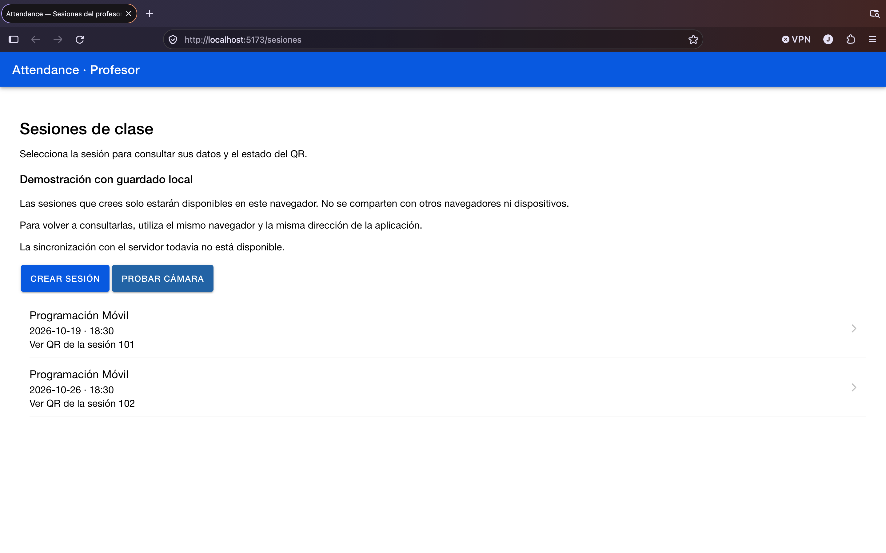
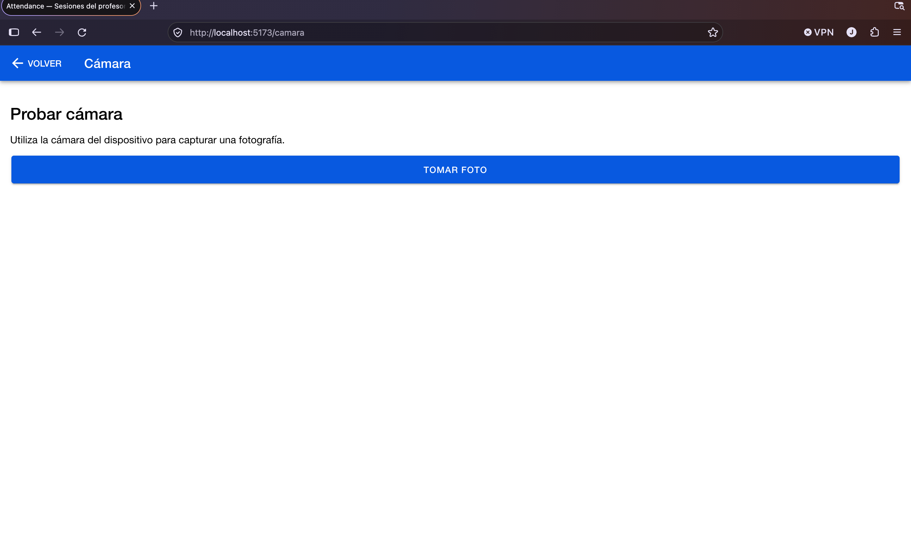

# Week 14 — Hardware Integration and Connectivity

## 1. Project Overview

This activity continues the development of the **Attendance Control** application using Ionic React, TypeScript, Vite, and Capacitor.

The application allows teachers to create class sessions, view session information, and access QR codes.

During Week 14, a new camera screen was integrated to demonstrate access to device hardware using Capacitor.

The objective is to improve the application by integrating native functionality, maintaining clear navigation, and verifying that existing features continue working.

## 2. Technologies Used

- Ionic React
- React
- TypeScript
- Vite
- Capacitor 7
- Capacitor Camera Plugin
- Vitest
- Android

## 3. Implemented Features

### 3.1. Session Management

The application displays a list of class sessions and allows teachers to create new sessions.

Session information is currently stored locally in the browser.

The main screen includes:

- Session list.
- Session creation.
- QR code navigation.
- Camera navigation.

### 3.2. Camera Integration

A new camera screen was implemented using the `@capacitor/camera` plugin.

The implementation includes:

- Navigation to the camera screen.
- A button to capture photographs.
- Camera permission handling.
- Loading indicators.
- Error messages when camera access fails.
- Photograph preview after a successful capture.
- Navigation back to the session list.

The camera screen is available through the `/camara` route.

### 3.3. Navigation

The existing application routes were preserved.

| Route | Description |
|---|---|
| `/sesiones` | Displays class sessions |
| `/sesiones/nueva` | Creates a new session |
| `/sesiones/:id/qr` | Displays session QR information |
| `/camara` | Opens the camera screen |

## 4. Screenshots and Evidence

### Evidence 1 — Session List

The following screenshot shows the main screen with the existing sessions and the new **Probar cámara** button.



**Figure 1.** Attendance Control session list with camera navigation.

### Evidence 2 — Camera Screen

The following screenshot shows the camera screen with the **Tomar foto** button and the option to return to the session list.



**Figure 2.** Camera interface implemented using Ionic React and Capacitor.

These screenshots verify that the navigation and camera interface are displayed correctly in the browser.

Native Android camera capture has not yet been documented.

## 5. Quality & Connectivity

The application was compiled successfully using `npm run build`.

The existing automated tests were executed using Vitest, with six tests passing and five tests marked as pending.

The camera integration uses Capacitor to access device hardware and manage camera permissions.

The interface includes loading indicators and error messages to provide feedback during camera operations.

The existing session management features and navigation routes were preserved.

The Android platform was added and synchronized successfully using `npx cap sync android`.

Token authentication, protected API requests, and HTTP 401 and network error handling remain pending implementation and verification.

## 6. Installation and Execution

### 6.1. Install Dependencies

From the repository root:

```bash
cd 14-week/03-optional-activity/app
npm install
```

### 6.2. Run the Web Application

```bash
npm run dev
```

Open the local URL displayed by Vite:

http://localhost:5173

### 6.3. Run Automated Tests

```bash
npm test
```

### 6.4. Build the Application

```bash
npm run build
```

### 6.5. Synchronize Android

```bash
npx cap sync android
```

### 6.6. Open Android Studio

```bash
npx cap open android
```

Android Studio and a configured Android SDK are required to build and run the native application.

## 7. Test Results

| Verification | Result |
|---|---|
| TypeScript compilation | Passed |
| Vite production build | Passed |
| Test files | 3 passed |
| Automated tests | 6 passed |
| Pending tests | 5 |
| Capacitor Android synchronization | Passed |
| Session list navigation | Verified in browser |
| Camera screen navigation | Verified in browser |
| Native Android camera capture | Pending verification |
| Token authentication | Pending implementation |
| Protected API connectivity | Pending implementation |

### Build Results

The application was compiled successfully using Vite.

The build generated the production files inside the `dist` directory.

Vite displayed a warning about large JavaScript chunks, but the compilation completed successfully.

### Unit Test Results

The automated tests produced the following results:

- 3 test files passed.
- 6 tests passed.
- 5 tests marked as TODO.
- No executed tests failed.

## 8. Challenges and Solutions

### Missing package-lock.json

The initial `npm ci` command failed because the application did not contain a `package-lock.json` file.

The issue was resolved by running:

```bash
npm install
```

### Gradle Download Error

During Android platform initialization, Gradle could not download its distribution because the server was unreachable.

However, the Android project was created successfully, and Capacitor synchronization completed without errors.

The native Android build still requires verification.

### Camera Error Handling

During browser testing, the camera initially displayed a generic error message.

The implementation was updated to display more specific error information and distinguish between web and native platforms.

## 9. Project Structure

```text
14-week/
└── 03-optional-activity/
    ├── README.md
    ├── evidence/
    │   ├── sessions-page.png
    │   └── camera-page.png
    └── app/
        ├── android/
        ├── src/
        │   └── app/
        │       ├── App.tsx
        │       ├── CameraPage.tsx
        │       ├── SessionList.tsx
        │       ├── SessionFormPage.tsx
        │       └── SessionQrPage.tsx
        ├── capacitor.config.ts
        ├── package.json
        └── package-lock.json
```

## 10. Conclusion

During Week 14, the Attendance Control application was extended with camera integration using Capacitor.

The application continues to compile successfully, and its existing automated tests pass.

The camera interface is accessible from the session list, and the implementation includes permission checks, loading feedback, and error handling.

The next steps are to verify camera capture on an Android device and implement authentication and protected API connectivity.
