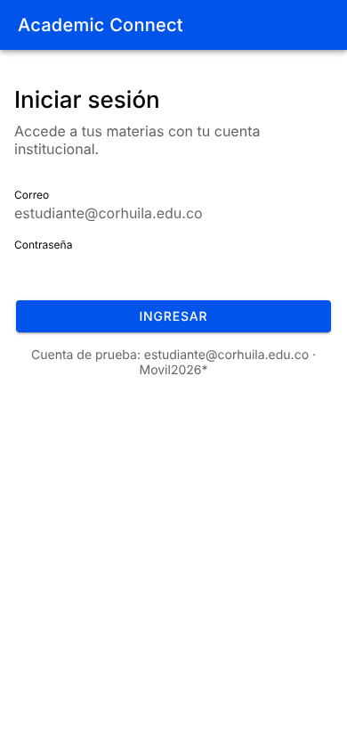
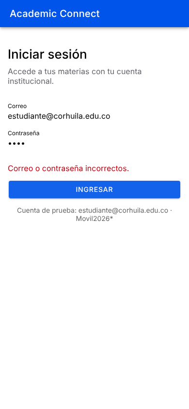
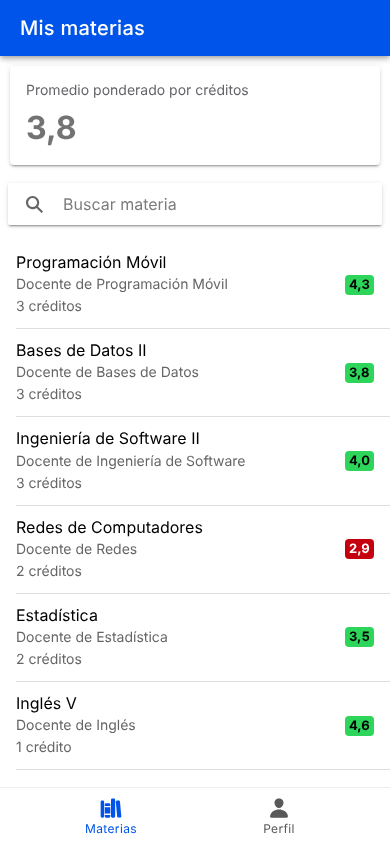
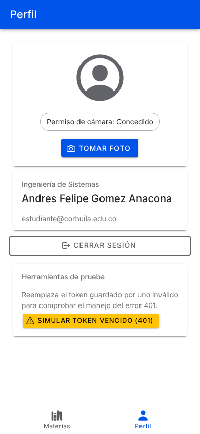
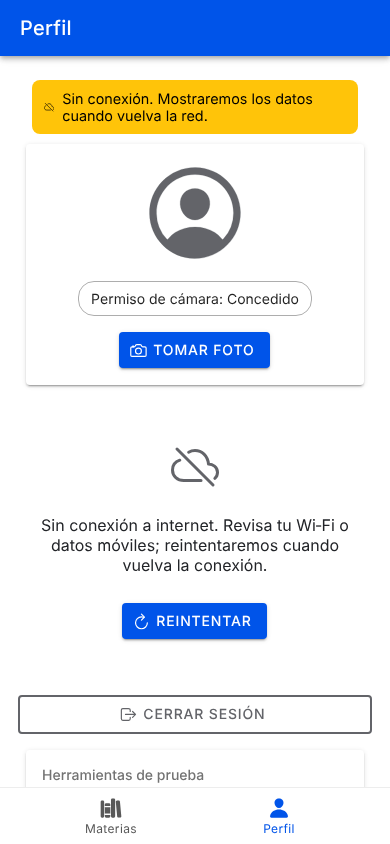
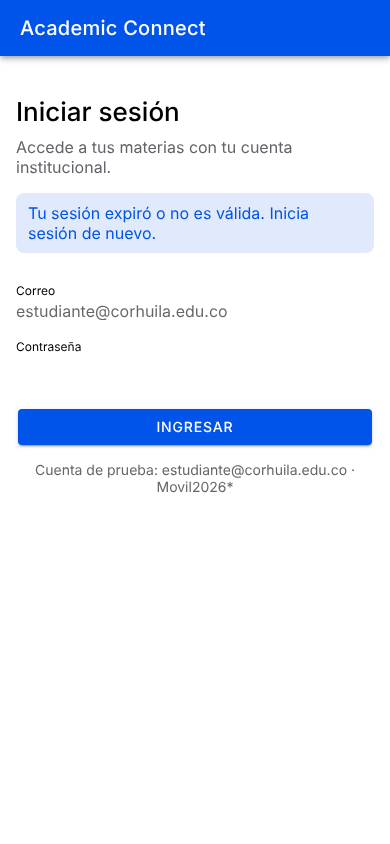
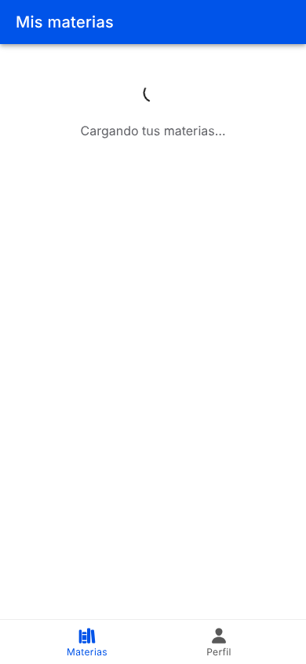
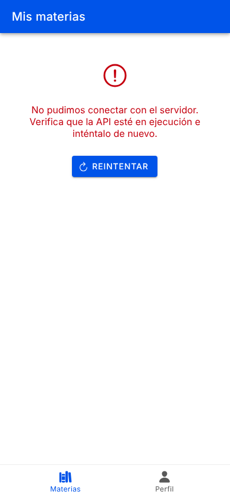

# Actividad Semana 14: App con hardware, conectividad, optimización y pruebas

## Información del Estudiante
- **Nombre Completo:** Andres Felipe Gomez Anacona
- **Usuario GitHub:** Andresfg20
- **Asignatura:** Programación Móvil - 2026-B
- **Semana:** Semana 14 (Corte 3)

---

## Descripción de la Actividad

**Academic Connect** es una app **Ionic React + Capacitor** (Android) conectada a una **API REST en Node.js/Express**. Cubre:

| Tema | Implementación |
|---|---|
| Hardware (plugin de Capacitor) | `@capacitor/camera`: foto de perfil con verificación y solicitud explícita del permiso (concedido / denegado / bloqueado / cancelado) |
| Login por token | `POST /api/login` devuelve un **JWT**; se guarda con `@capacitor/preferences` |
| Petición protegida | `GET /api/subjects` y `GET /api/profile` con cabecera `Authorization: Bearer <token>` |
| Error 401 | Limpia el token y la caché, muestra "Tu sesión expiró…" y redirige a `/login` |
| Sin conexión | `@capacitor/network`: no se envían peticiones sin red, aviso visible, botón **Reintentar** y reintento automático al volver la red |
| UX | Estados **Loading / Data / Error** en cada vista remota; flujo login → vista protegida → cerrar sesión |
| Optimización (Semana 14) | Caché de GET + petición compartida, `React.memo`, `useMemo` y `key` estables, **medidos antes/después** |
| Pruebas | **28 pruebas unitarias** (Vitest) en la app y **6 pruebas** de la API (`node:test`) |

---

## Estructura de la Entrega

```
14-week/hu-status/
├── README.md
├── docs/screenshots/            # Evidencia de ejecución
├── server/                      # API REST (Express + JWT)
│   ├── app.js                   # Endpoints y middleware requireAuth
│   ├── server.js                # Arranque (puerto 3000)
│   └── test/server.test.js      # Pruebas de login, 401 y token vencido
└── app/                         # Ionic React + Capacitor
    ├── capacitor.config.ts
    ├── android/                 # Proyecto Android (permisos CAMERA, INTERNET, ACCESS_NETWORK_STATE)
    └── src/
        ├── core/                # apiClient (interceptor), errors, tokenStorage, networkService, config
        ├── services/            # authService, academicService, cameraService, container
        ├── context/             # AuthContext (sesión y manejo del 401)
        ├── hooks/               # useRemoteData (Loading/Data/Error + reintento), useNetworkStatus
        ├── components/          # StateViews, OfflineBanner, SubjectItem (memo), RequireAuth, AuthRedirects
        ├── pages/               # LoginPage, SubjectsPage, ProfilePage
        ├── utils/               # academicMath (promedio ponderado y formato de notas)
        └── __tests__/           # Medición de la optimización y utilidades de prueba
```

---

## Cómo ejecutar

### 1. API (terminal 1)
```bash
cd 14-week/hu-status/server
npm install
npm start            # http://localhost:3000
```
Cuenta de prueba: **estudiante@corhuila.edu.co / Movil2026\***

Variables opcionales: `TOKEN_TTL_SECONDS` (vida del token; por defecto 300 s), `JWT_SECRET`, `PORT`.

### 2. App en el navegador (terminal 2)
```bash
cd 14-week/hu-status/app
npm install
npm run dev          # http://localhost:5173
```

### 3. App en Android (emulador o dispositivo)
```bash
cd 14-week/hu-status/app
npm run build
npx cap sync android
npx cap open android # en Android Studio: Run ▶
```
- **Emulador:** la app usa `http://10.0.2.2:3000` automáticamente.
- **Celular real:** crea `app/.env` con `VITE_API_URL=http://<IP-de-tu-PC>:3000` (misma red Wi‑Fi), luego `npm run build` y `npx cap sync android`.

### 4. Pruebas
```bash
cd 14-week/hu-status/app && npm test           # 28 pruebas unitarias (Vitest)
cd 14-week/hu-status/app && npm run measure    # medición antes/después de la optimización
cd 14-week/hu-status/server && npm test        # 6 pruebas de la API
```

---

## Optimización con medición (antes / después)

**Pantalla optimizada:** "Mis materias" (lista protegida con búsqueda).

| Problema medido | Antes | Después | Técnica |
|---|---|---|---|
| Peticiones HTTP al entrar 5 veces a la lista (cada entrada dispara el montaje y `ionViewWillEnter`) | **10** | **1** (−90 %) | Caché de respuestas GET (60 s) en `apiClient` y petición compartida para llamadas idénticas simultáneas |
| Re-renderizados de filas al escribir 10 letras en el buscador (300 filas) | **3000** | **0** | `React.memo` en `SubjectItem`, `key={subject.id}` y `useMemo` para el filtro y el promedio |
| Tiempo de esos 10 re-renderizados (jsdom) | ~300–370 ms | ~23–37 ms | Mismo cambio (el tiempo varía según el equipo; los conteos son exactos) |

Resultado de `npm run measure`:
```
┌──────────────────────────┬────────┬───────┬───────────┐
│ (index)                  │ before │ after │ reduction │
├──────────────────────────┼────────┼───────┼───────────┤
│ HTTP requests (5 visits) │ 10     │ 1     │ '90 %'    │
└──────────────────────────┴────────┴───────┴───────────┘
┌──────────────────┬─────────┬────────┐
│ (index)          │ before  │ after  │
├──────────────────┼─────────┼────────┤
│ Row re-renders   │ 3000    │ 0      │
│ Time (ms, jsdom) │ '373.0' │ '23.1' │
└──────────────────┴─────────┴────────┘
```
La caché se vacía al cerrar sesión y ante un 401, y "deslizar para actualizar" o **Reintentar** fuerzan una petición nueva, así que la optimización no muestra datos de otra sesión.

---

## Resultado de las pruebas

```
✓ src/__tests__/optimization.measure.test.tsx (2 tests)
✓ src/hooks/useRemoteData.test.tsx (3 tests)
✓ src/core/apiClient.test.ts (10 tests)
✓ src/services/authService.test.ts (3 tests)
✓ src/services/cameraService.test.ts (5 tests)
✓ src/utils/academicMath.test.ts (4 tests)
✓ src/core/errors.test.ts (1 test)
Test Files  7 passed (7)
     Tests  28 passed (28)

API (node --test): 6 pass, 0 fail
```

| Archivo de prueba | Qué verifica |
|---|---|
| `utils/academicMath.test.ts` | Cálculo del promedio ponderado por créditos y formato de notas ("4,0", "—") |
| `core/apiClient.test.ts` | Envío del `Bearer`, 401 limpia la sesión, sin red no se hace la petición, errores de red/HTTP, caché y deduplicación |
| `services/authService.test.ts` | Login guarda el token, credenciales inválidas no guardan nada, logout lo borra |
| `services/cameraService.test.ts` | Permiso concedido, solicitado y concedido, denegado, bloqueado y cámara cancelada |
| `hooks/useRemoteData.test.tsx` | Estados Loading → Data, Error → Reintentar y reintento automático al volver la red |
| `core/errors.test.ts` | Mensajes claros para cada tipo de error |
| `__tests__/optimization.measure.test.tsx` | Medición antes/después de la optimización |

---

## Guía de pruebas manuales

**Permisos de cámara (Android):** Perfil → **Tomar foto**.
1. Primera vez: aparece el diálogo del sistema. **Permitir** abre la cámara y la foto queda como avatar.
2. **No permitir**: mensaje "Denegaste el permiso…"; la app sigue funcionando y se puede volver a intentar.
3. Si se niega de nuevo, Android lo bloquea: mensaje con la ruta de Ajustes. Para reiniciar: *Ajustes → Apps → Academic Connect → Permisos → Cámara*.
4. El chip "Permiso de cámara" muestra el estado actual.

**Login:** con la API encendida, entra con la cuenta de prueba. Una contraseña incorrecta muestra "Correo o contraseña incorrectos."

**Error 401 (tres formas):**
1. Perfil → **Simular token vencido (401)**: reemplaza el token por uno inválido y repite la petición protegida.
2. Inicia la API con `TOKEN_TTL_SECONDS=20 npm start` (en PowerShell: `$env:TOKEN_TTL_SECONDS=20; npm start`), espera 20 s y desliza hacia abajo en "Mis materias".
3. Reinicia la API con otro secreto (`JWT_SECRET=otro npm start`): el token anterior deja de ser válido.

En todos los casos la app borra el token y redirige a **Iniciar sesión** con el aviso "Tu sesión expiró o no es válida. Inicia sesión de nuevo."

**Sin conexión:** activa el **modo avión** (o en el navegador DevTools → Network → *Offline*). Aparece el aviso amarillo y, al pedir datos, el estado de error "Sin conexión a internet…" con **Reintentar**, sin enviar peticiones. Al quitar el modo avión la vista se recarga sola. Si la API está apagada (con red), se muestra "No pudimos conectar con el servidor…".

---

## Evidencia de Ejecución

| Login | Credenciales inválidas | Vista protegida (Data) | Perfil + cámara |
|---|---|---|---|
|  |  |  |  |

| Sin conexión | Después de un 401 | Loading | Error (servidor caído) |
|---|---|---|---|
|  |  |  |  |

---

## Quality & connectivity

The app uses the official **`@capacitor/camera`** plugin to take a profile photo, together with **`@capacitor/network`** to read the connectivity state and **`@capacitor/preferences`** to persist the session token. Camera permission handling is explicit: `cameraService` first calls `checkPermissions()`, requests the permission with `requestPermissions({ permissions: ['camera'] })` only when its state is `prompt` or `prompt-with-rationale`, and maps the outcome to *granted*, *denied* or *blocked* (permanently denied), showing a specific Spanish message for each case and never opening the camera without permission; `CAMERA` is declared in `AndroidManifest.xml` so Android shows the runtime dialog. Authentication is token based: `POST /api/login` returns a short-lived JWT signed by the Express API, the token is stored in Preferences (private app storage), and a single `apiClient` acts as the HTTP interceptor that adds the `Authorization: Bearer <token>` header to every protected request such as `GET /api/subjects` and `GET /api/profile`. When a protected request answers **401 Unauthorized** (missing, tampered or expired token), the client removes the token, clears the response cache, notifies `AuthContext`, and the app shows "Tu sesión expiró…" and redirects to the login screen, while a 401 on the login form itself only reports invalid credentials. Before every request the client checks `Network.getStatus()`; when the device is offline it throws an `OfflineError` without calling the server, the screens show an offline banner and an error state with a **Retry** button, and a `networkStatusChange` listener reloads the data automatically when the connection returns (an unreachable server is reported separately as a network error). Every remote screen implements explicit Loading, Data and Error states through the `useRemoteData` hook, and the list screen was optimized with a GET cache, shared in-flight requests and `React.memo` rows, reducing HTTP calls from 10 to 1 and row re-renders from 3000 to 0 in the measured scenario. Testing combines 28 Vitest unit tests (token handling, 401 and offline behaviour in the API client, camera permission flows, Loading/Data/Error states, error messages, grade calculations and the before/after optimization measurement) with 6 `node:test` integration tests of the API that cover valid login, wrong credentials, missing, tampered and expired tokens.
